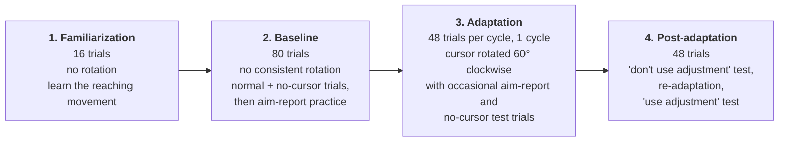
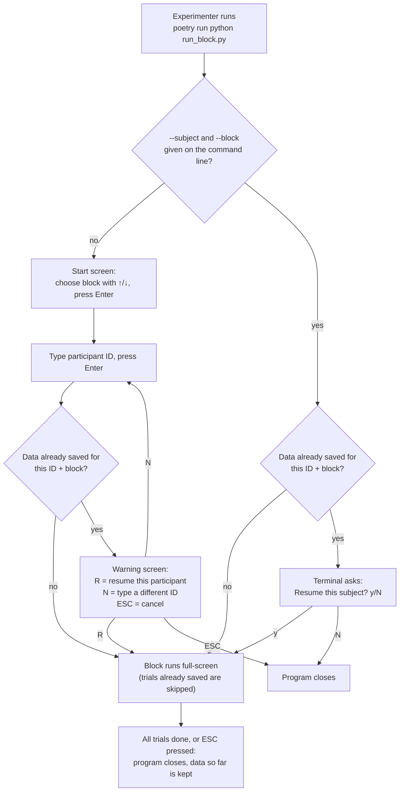
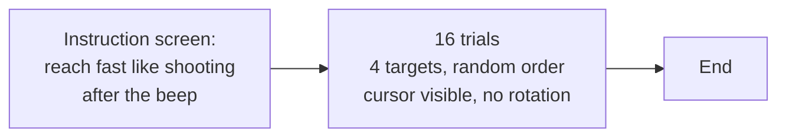
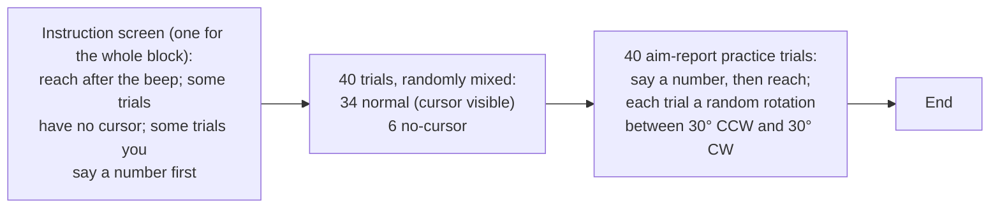
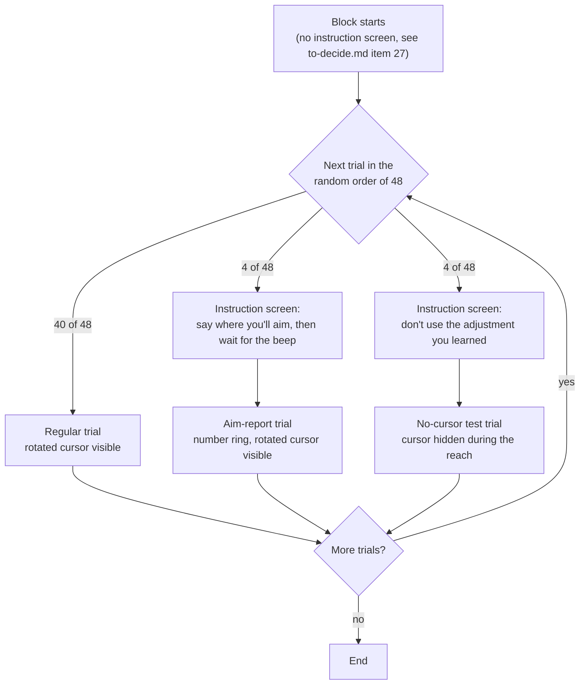
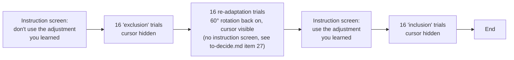
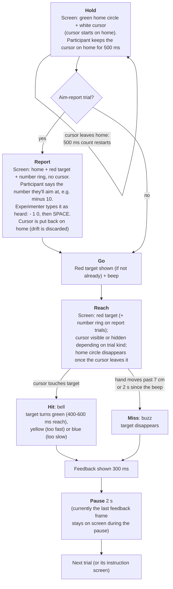

# Visuomotor Rotation Task

A center-out reaching task with a visuomotor rotation and explicit
aiming reports (Taylor, Krakauer & Ivry, 2014 design), run locally on a Mac
with pygame. The participant slides a finger on a trackpad, hidden under an
occluder, to move a cursor from the screen centre to a target. In some
blocks the cursor's movement is rotated 60° clockwise relative to the hand,
and on some trials the participant says aloud where they are aiming before
reaching.

Other documents:
- `caution.md`: **read before every session**. Pre-flight checklist and
  setup traps that can silently spoil data.
- `to-decide.md`: design choices that are still open or provisional,
  explained in plain language, to settle with pilot testing.

## Hardware

| Item | Notes |
|---|---|
| Mac running macOS | Screen size and the "Main Display" are detected through macOS APIs. Keep the power adapter connected during sessions. |
| Apple Magic Trackpad 3 | Charged or wired, paired, placed at a fixed marked position on the table. |
| Occluder | Hides the hand and trackpad from the participant. Must not touch the trackpad surface. |
| Headphones | For the go beep, hit bell and miss buzz. |
| Keyboard | Reachable by the **experimenter only**. Used for the start screen, SPACE to continue, and typing aim reports. |
| External monitor (optional) | Must be set as **Main Display** before launch (see [Multi-monitor](#multi-monitor)). |

Several macOS settings (trackpad gestures, pointer acceleration, Do Not
Disturb, True Tone, etc.) **must** be changed before the first session.
They are listed with how to verify them in `caution.md`.

## Software setup

Requirements: Python 3.12 and [Poetry](https://python-poetry.org/).

```bash
git clone <this repo> && cd visuomotor-rotation-task
poetry install                 # installs pygame-ce, pandas, etc. and the vmr package
poetry run pytest -q           # sanity check: all tests should pass, no screen needed
```

The sound files (`go_beep.wav`, `hit_bell.wav`, `miss_buzz.wav`) are already
in `assets/audio/`. If one is missing, the program warns and plays silence
instead of crashing.

**Display calibration (px/cm) is automatic.** Each time a block starts, the
program reads the screen's physical size from macOS and converts the task's
real-world distances (e.g. target 7 cm from home) into pixels. Nothing to
set up. If a monitor reports its size wrongly (reaches feel too long or too
short), override it once with a ruler measurement:

```bash
poetry run python -m vmr.display_calibration                 # saves display_calibration.json
poetry run python -m vmr.display_calibration --recalibrate   # redo it
rm display_calibration.json                                   # go back to auto-detection
```

The value actually used is saved with each session in
`data/<subject>/<block>/calibration_used.json` (see `to-decide.md` #18).

## How the experiment runs

### 1. Overview: four blocks

A full session is four blocks, run in this order. **Each block is a separate
launch** of the program: when a block finishes, the program closes, and the
experimenter launches the next one.



### 2. Launching a block



### 3. Screens inside each block

Instruction screens show the Chinese instruction text and stay up until the
experimenter presses SPACE. "Trial" boxes are the single-trial sequence in
section 4.

**Familiarization**



**Baseline**



No new instruction screen appears between the two parts of baseline.

**Adaptation** (60° clockwise rotation throughout)



With more than one cycle (`config.yaml` → `n_cycles`), the 48-trial mix
repeats once per cycle.

**Post-adaptation** (fixed order for everyone)



### 4. A single trial

Every trial in every block follows the same sequence; trial kinds differ
only in whether the cursor is visible during the reach, whether it is
rotated, and whether there is an aim report (table below).



On no-cursor trials the hit test uses the hidden hand position, so the
participant still hears the bell or buzz and sees the target change.

| Trial kind | Block | Cursor during reach | Rotation | Aim report |
|---|---|---|---|---|
| familiarization | Familiarization | visible | none | no |
| baseline_veridical | Baseline | visible | none | no |
| baseline_no_vision | Baseline | hidden | none | no |
| baseline_report_training | Baseline | visible | random, 30° CCW to 30° CW | yes |
| adaptation_regular | Adaptation | visible | 60° CW | no |
| adaptation_report | Adaptation | visible | 60° CW | yes |
| adaptation_return_to_baseline | Adaptation | hidden | none (not visible) | no |
| post_exclusion | Post-adaptation | hidden | none (not visible) | no |
| post_readaptation | Post-adaptation | visible | 60° CW | no |
| post_inclusion | Post-adaptation | hidden | none (not visible) | no |

The "trial kind" names are the values in the `trial_type` column of
`trials.csv`.

## Running a session

Go through the checklist at the end of `caution.md` first.

```bash
poetry run python run_block.py                                       # start screen: pick block + type ID
poetry run python run_block.py --subject S01 --block familiarization  # skip the start screen
poetry run python run_block.py --subject S01 --block baseline --windowed  # in a window, for testing only
```

| Flag | Meaning |
|---|---|
| `--subject` | Participant ID. Spaces around it are removed; upper/lower case matters (`S01` ≠ `s01`). |
| `--block` | `familiarization`, `baseline`, `adaptation` or `post_adaptation`. |
| `--seed` | Number that fixes the random trial order. Leave out for a new random order (it is saved in `schedule.csv`). Pass the saved one when resuming, see below. |
| `--data-dir` | Where data are saved (default `./data`). |
| `--windowed` | Run in a 1280×800 window instead of full-screen. For development only. |
| `--yes` | Skip the "data already exists, resume?" question. |

**ESC** quits at any time; every finished trial is already saved.
Re-running the same participant ID and block **resumes**: trials already
saved are skipped, never repeated or overwritten. To keep the originally
planned trial order when resuming, pass the original seed (`seed` column of
that block's `schedule.csv`) with `--seed` (`to-decide.md` #34).

### Multi-monitor

The program opens full-screen on the display macOS calls **Main Display**
(the one with the menu bar), not necessarily the laptop screen and not
necessarily the larger one. To use an external monitor, open System
Settings → Displays → Arrangement and drag the white menu-bar strip onto it
before launching (`to-decide.md` #31). With one screen there is nothing to
set.

## Data layout

```
data/<subject_id>/<block_name>/
  trials.csv              one row per trial (see vmr/trial.py::TrialResult)
  samples.csv             one row per recorded finger-position sample
  schedule.csv            the planned trial order for this block, with its seed
  config_snapshot.yaml    the config.yaml in force when the block started
  calibration_used.json   the px/cm value used, and whether auto-detected or measured
```

`data/` is not tracked by git. **Back it up after every session.**

## Development

```bash
poetry run pytest                                   # all tests, headless, no screen/sound needed
poetry run marimo edit notebooks/check_session.py   # QC: hit rate, trajectories, missing reports
poetry run marimo edit notebooks/calibration.py     # QC: calibration, pointer-acceleration check, sampling rate
```

Tests run headlessly via pygame's dummy video/audio drivers
(`tests/conftest.py`).

## Project layout

```
vmr/
  config.py                typed config.yaml loader
  geometry.py              pure math: positions, rotation, hit tests, trajectory angles
  schedule.py              trial-list generation for all four blocks
  trial.py                 the trial state machine (TrialRunner)
  report_entry.py          experimenter's aim-report entry logic
  input_device.py          relative-mouse cursor tracking
  audio.py                 sound loading/playback
  display.py               rendering and instruction texts
  menu.py                  start screen (起始畫面) logic + rendering
  display_calibration.py   px/cm detection and manual override
  logging_io.py            CSV writers
  orchestration.py         ties everything together (run_block, main)
run_block.py               the command to launch a block (wraps vmr.orchestration.main)
config.yaml                all experiment parameters
assets/audio/              go beep, hit bell, miss buzz
notebooks/                 marimo QC notebooks
tests/                     tests for every module above
caution.md                 pre-session checklist and setup traps
to-decide.md               open and provisional design decisions
```

## Known gaps

See `to-decide.md` section A for details.

- No instruction text exists for entering the adaptation block or the
  re-adaptation part of post-adaptation (#27).
- Resuming an interrupted block uses a new random order unless the original
  `--seed` is passed (#34).
- Achieved sampling rate not yet measured on the real hardware (#17).
- Hit-zone size and other spatial defaults are provisional until piloting
  (#12 and the rest of section B).
